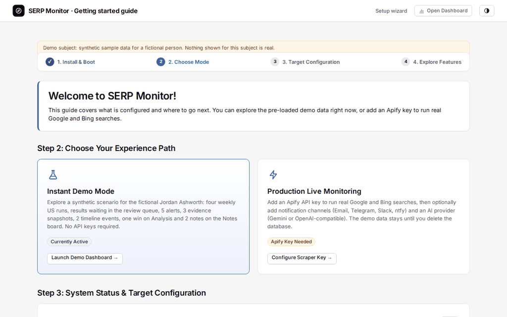
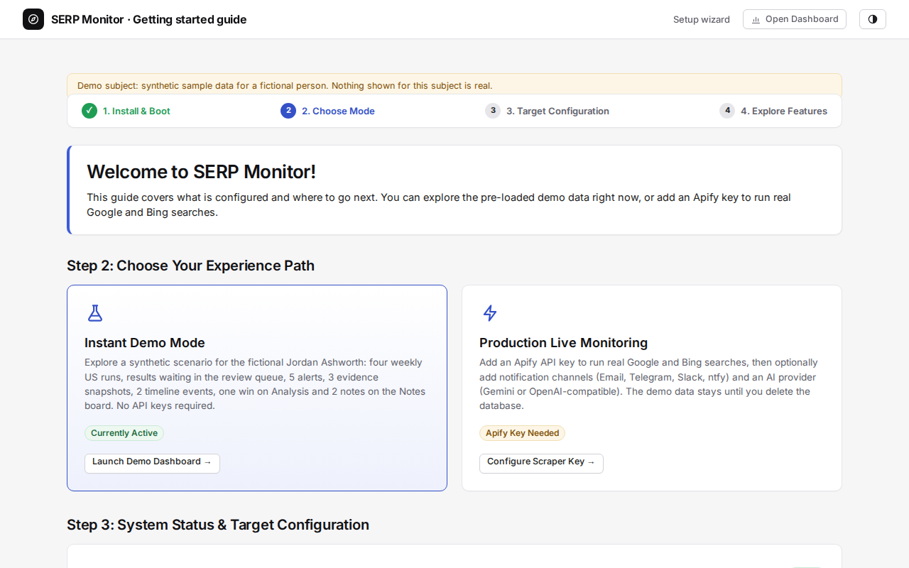
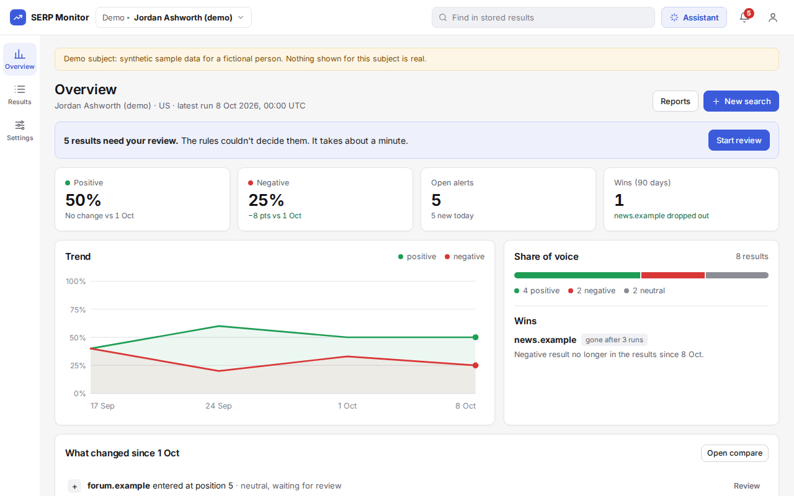
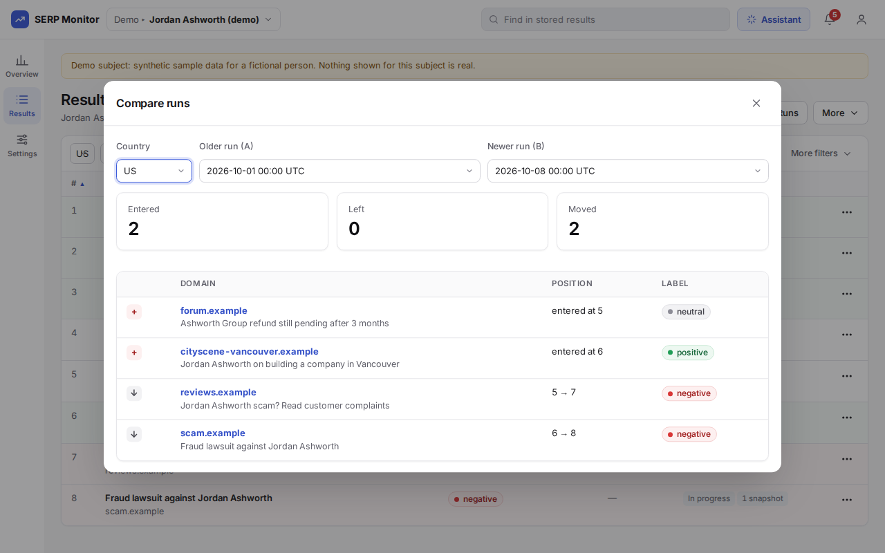
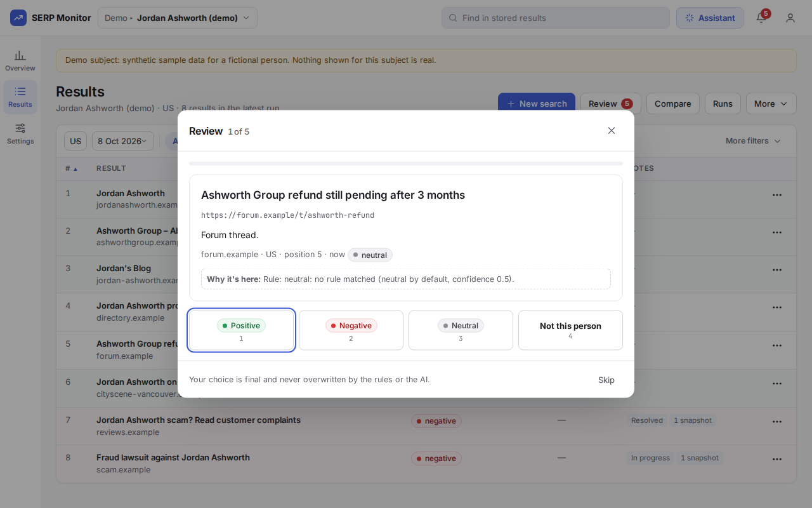
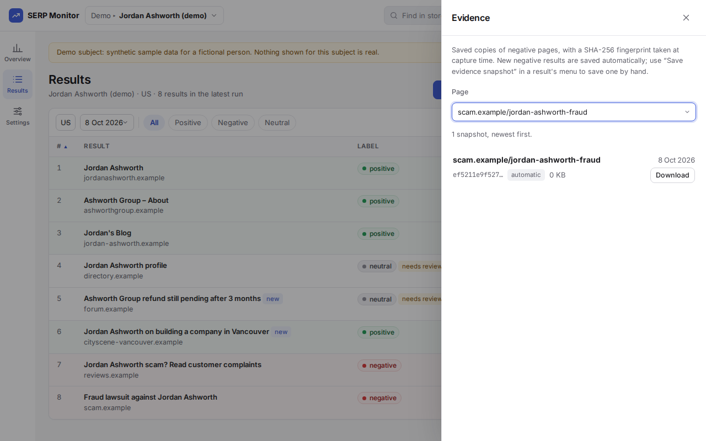

# SERP Monitor

[](https://github.com/carlspareds/serp-monitor/actions/workflows/tests.yml)

When someone searches your name (or your business's name) on Google, what
shows up matters, and it changes without warning. SERP Monitor tracks
those search results: it runs searches through [Apify](https://apify.com),
labels each result positive, negative, or neutral with a small rule
engine, keeps the history in SQLite, and raises alerts when the stored
data crosses a rule. It is a self-hosted FastAPI app for one person or a
small team, not an enterprise SEO platform.

The most useful thing in it may be the eval that shows its classifier
doesn't work on real data. See
[Honest limitations](#honest-limitations) and
[`evals/README.md`](evals/README.md).



<details>
<summary><b>Screenshots (1280x800, synthetic demo data from <code>make run</code>)</b></summary>
<br>

| Onboarding guide (`/onboarding`) | Dashboard home (`/`) |
| :---: | :---: |
| [](docs/screenshots/onboarding.png) | [](docs/screenshots/dashboard_home.png) |

| Compare (Results → Compare) | Review (Results → Review) |
| :---: | :---: |
| [](docs/screenshots/diff_view.png) | [](docs/screenshots/review_queue.png) |

| Evidence (Results → More → Evidence) |
| :---: |
| [](docs/screenshots/evidence_vault.png) |

The images are regenerated from a freshly seeded database by
`scripts/capture_demo_screenshots.py`, so they show what a fresh
`make run` shows.

</details>

## What it does

- **Searches** Google (desktop and mobile) and Bing (desktop only) through
  Apify's hosted scraper actors, across the countries you pick, on demand
  from Results → New search (a dialog; progress follows in a side panel). The only *scheduled* search
  is the weekly report: Monday 08:00 UTC by default (editable in Settings →
  General → Scheduling), Google desktop, the tracked name of every active,
  non-demo subject (see [Projects and subjects](#projects-and-subjects)). The scheduler
  also sends a daily info-digest email and runs a weekly purge.
- **Classifies** every result with rules only: your positive-domain list,
  a negative-domain blacklist, and a short negative-keyword list
  (`config/positive_domains.py`). A rule hit gets confidence 1.0; a result
  no rule decides is "neutral" at 0.5, which is below the default review
  threshold (0.7), so it lands in the human review queue (Results → Review).
  There, a person confirms or corrects the label, and that verdict is not
  overwritten by later bulk reclassification.
- **Alerts** on stored data: a negative-result threshold per country
  (weighted by severity), a URL that is newly negative compared with the
  previous run, a tracked negative URL dropping out of the results, Apify
  budget reached, a scheduled job missing its window, and an overdue note.
  These rules run after a weekly-report run, in a daily 09:00 UTC check
  over what is already stored, and from a manual button on `/alerts`. An
  on-demand search does not run them itself, except two that can fire on
  any search: a tracked negative URL dropping out (`url_gone`) and the
  Apify budget (`apify_budget`). There is no ranking-drop alert. Alerts go
  to email, Telegram, Slack, or [ntfy](https://ntfy.sh) according to a
  per-severity routing table on the Alerts page (`/alerts#routing`; by
  default, `warning` alerts go to email only).
- **Captures evidence** for newly negative results: a best-effort download
  of the raw HTML of the *result page itself* (not of the search results
  page), once per URL, at most 10 per run, skipping results marked as a
  different person. A negative result can also be captured by hand from
  Results (the result's ⋯ menu), and Results → More → Evidence lists every snapshot. The file's SHA-256 is stored in the same SQLite
  database, which lets you check that the file hasn't changed since; it is
  not a legal chain of custody. Evidence is purged after 365 days by
  default (the `PURGE_EVIDENCE_DAYS` row of the `settings` table; there is
  no UI for retention).
- **Optional AI provider features** (Gemini or any OpenAI-compatible API,
  such as OpenAI, OpenRouter, or a local Ollama / LM Studio server; set in
  Settings → General → AI provider): same-name (not this person)
  detection, a 1-5 severity score for negatives, a manual "Relabel with
  AI" button (AI labels come with a one-line reason, shown in "Why it's
  here"), a "Run AI checks" button that re-runs same-name and severity on
  the latest stored results that don't have them yet (for example after
  the provider was down during a search; capped at 30 results per check
  per click), and a narrative summary in the PDF report (left out, with a
  one-line "AI summary unavailable: reason" note, when the AI call fails).
  Without a provider, the only same-name handling is the manual
  "Not this person" button in the Review dialog, and every negative counts as
  severity 3. The AI paths have no eval.
- **Reasoning models work** (DeepSeek, OpenAI o-series/gpt-5, Gemini 2.5
  "thinking", Qwen3...). They spend part of the output budget on hidden
  reasoning, so every AI call asks for at least 1024 output tokens (labels,
  severity, same-name, the Settings test) or 2048 (PDF summary, assistant).
  An empty answer is reported as a failure ("The model returned no
  answer...") instead of an empty success; a reply cut off by the token
  limit is retried once with double the budget (at most 8192). For
  OpenAI-compatible servers the app sends `reasoning_effort` (default
  `low`, `AI_REASONING_EFFORT` to change or `off`) and falls back to
  `max_completion_tokens` when a server rejects `max_tokens`; a server
  that rejects either is remembered for that model until restart.
- **Reports and integrations:** a weekly summary email, a PDF summary and
  an Excel workbook export, and a JSON API (`/api/v1`, API keys with
  scopes, optionally limited to one subject) that reads results/runs/
  alerts/stats per subject and can update an alert's status
  (`PATCH /api/v1/alerts/{id}`).
- **Records** a timeline of real-world events, a run-to-run comparison (Compare, older run A against newer run B), and an
  audit log of every write made through the dashboard.

## Screens and workflow

Three destinations in the left rail (a bottom tab bar on phones):
**Overview**, **Results** and **Settings**. Everything else opens as a dialog
or a side panel over the page you are on, so you never lose your place.
The top bar has the *Project ▸ Subject* switcher, "Find in stored results",
the Assistant, the background-search chip, the alerts bell and the account
menu.

**Background searches.** While a search runs, a chip next to the bell says
"Searching… 0:42" ("2 searches running" when several); it turns into "Search
finished" or "Search failed" afterwards and stays until you open it. Clicking
it opens the search's progress panel (or a short list when there are
several). It survives reloads and page changes, and a toast tells you when a
search finishes ("Search for Jordan Ashworth finished: 7 results, 1 new
negative", with View results) or fails (with Details).

**Results** shows the active subject's latest run (or a chosen run date) for
one country: a one-row filter bar (country, run date, label chips, "More
filters": same-name results, severity 3 or higher, has a note, only new since
the last run) and a sortable table (position, result, label with a "needs
review" tag, severity, note and evidence tags). Each row's ⋯ menu: add or
edit a note, save an evidence snapshot (negatives), change the label, mark
the domain as yours or negative (one click, same lists as Settings), show the
domain on the timeline, ask the assistant about it, open the page. Results is
the one home of New search, Review, Compare, Reports and the AI checks; the
Overview only has single shortcuts to the same dialogs. The toolbar opens:

| Tool | Opens as | What it does |
| --- | --- | --- |
| New search | dialog → side panel | Pick the subject, countries and (when several are configured) engines; the search runs in the background and the side panel shows one status box: what it is doing now ("Searching Google in the United Kingdom (2 of 6)…", "Waiting for Apify… 0:35", "Checking same-name results with AI…"), a progress bar, the elapsed time and the countries and engines on one line; the per-country steps are under a collapsed Details (opened by itself when one fails). "Run in background" closes the panel (the top-bar chip keeps track); "View results" switches to that subject. Disabled, with a link to Settings → Search, until an Apify key is set. |
| Review | dialog | One uncertain result at a time ("3 of 7", progress bar): Positive / Negative / Neutral / Not this person (keys 1-4), Skip. Your verdict is final: rules and AI never overwrite it. |
| Compare | dialog | Older run A vs newer run B of a country: entered, left, moved, label changes. |
| Runs | side panel | "Running now" (the subject's searches in progress, each opens its progress panel), then every run with its counts; open one, compare it with the previous one, delete it (admins). |
| More → Timeline | side panel | Log an event (press release, removal request…) and see its measured effect two weeks later; changes detected between runs are listed too. |
| More → Evidence | side panel | Saved copies of negative pages with their SHA-256 fingerprint, per page. |
| More → Notes | side panel | Notes by status (open, in progress, escalated, resolved, dismissed), overdue ones flagged. |
| More → Reports | dialog | New report: pick what it's for (PDF to share, Excel to analyse, CSV for tools), the subject, countries and period, check the preview, create, download. Previous reports lists every file of the subject, including the weekly report. |
| More → AI checks | dialog | "Relabel with AI" (what the rules leave neutral) and "Run AI checks" (same-name and severity on the latest runs, up to 30 per check per click), with the counts waiting now. Disabled, with a link to Settings → AI provider, until a provider is set up. |

Domains (your positive domains and the negative list, plus "Apply to stored
results") live with each subject in **Settings → Projects and subjects**.

Old addresses (`/runs`, `/run/<id>`, `/diff`, `/review`, `/timeline`,
`/evidence`, `/notes`, `/export`, `/search_page`) redirect to Results with
the matching dialog or panel open, and `/domains` to the active subject's
Domains in Settings, so bookmarks keep working.

## Run it

Requires Python 3.12 (the only version CI tests) and `make`.

```
make run
```

This creates a virtualenv, installs dependencies, copies `.env.example` to
`.env` if missing (readable by you only), seeds a synthetic demo (see
`DATA.md`) if the database is empty, and serves the dashboard on
`127.0.0.1:8000` (open it in your browser yourself). Re-running it is safe:
every step is skipped if already done. `make run` also starts the embedded
scheduler (weekly report, daily alert check, daily info digest, weekly
purge, watchdog); set `DISABLE_SCHEDULER=1` to turn it off.

**Sign-in is required.** The first time you open it, it asks you to
**create the admin account** (username and a password of at least 12
characters; a passphrase works well), signs you in and shows the demo.
Nothing else is served until that account exists, so create it right
away. For a quick look on your own machine without an account, run
`make demo` instead: it sets `ALLOW_NO_AUTH=1`, which works only on
`127.0.0.1` (the app refuses to start with it on any other address, serves
it to local clients only, and ignores it as soon as an account exists).

The demo needs no API keys: four weekly US runs for the fictional Jordan Ashworth, results waiting in the review queue, 5 alerts, 3 evidence snapshots, 2 timeline events, one win on Analysis (a negative result that dropped out of the top) and 2 notes on the Notes board. The evidence snapshots are synthetic pages (the
`.example` domains don't resolve) passed through the real hashing and
storage code.

In-app pages worth knowing:

- `/setup`, a setup wizard: Apify key, optional integrations (AI provider,
  email, Telegram, Slack, ntfy), the admin account (already done if you
  created it on the first visit; it can't be skipped), and the tracked
  name. The other steps are skippable and the wizard resumes where you
  left off, because it reads the real persisted config. Re-opening a step and
  submitting values saves them even after it was skipped. Everything it
  sets can also be changed later in Settings (General and Notifications).
- `/onboarding`, the Getting started guide: a checklist that reflects what
  is actually configured.

A demo-mode banner stays on every page until a real Apify key is set.

Accounts have one of three roles: `admin` (everything, including
settings, secrets, backups, users and API keys), `operator` (day-to-day
work such as searches, alerts and notes) and Viewer (read-only; stored as
the `client_viewer` role). Add them in Settings → Users. An optional env
admin can also be set with `AUTH_USER`/`AUTH_PASS` in `.env`. Sign-in is
rate limited and locks for 60 seconds (doubling up to an hour) after 5
failures, sessions expire after 2 hours idle or 12 hours in total, and
form posts from another origin are rejected. See
[`SECURITY.md`](SECURITY.md) for everything else.

### Going from the demo to real data

The demo runs and their alerts and evidence stay in the database when you
add a real Apify key. To start clean, stop the app, delete
`data/seo_dashboard.db` and `data/evidence/`, then start the server
directly with `.venv/bin/uvicorn dashboard.main:app --app-dir src --port 8000`
(the new database has no accounts, so the first visit asks you to create
the admin account again). `make run` would re-seed the empty database with
the demo. Also edit
`config/positive_domains.py`: its `POSITIVE_DOMAINS` list is hardcoded to
the fictional Jordan Ashworth domains and is merged with whatever domains
you add in the UI.

### Checking the configuration

`make check` (or `.venv/bin/python scripts/check_config.py`) validates `.env`
and the environment without starting anything, prints one OK / INFO / WARN /
ERROR line per item plus which variables are set (values are never shown),
and exits 1 if there is an error. `make run` runs it first, and the same
checks run once at server startup: errors stop the server with a list of
what to fix, warnings are logged as one line. Set `SKIP_CONFIG_CHECK=1` to
bypass both.

Missing keys are never errors: with none at all you get the demo. Only
broken settings are:

| Variable | Without it | Error when |
|---|---|---|
| `APIFY_API_KEY` | demo mode, no real searches (warning) | — |
| `AUTH_USER` / `AUTH_PASS` | no env admin: the first visit creates the admin account | only one of the two is set (warning if `AUTH_PASS` is under 12 characters) |
| `ALLOW_NO_AUTH` | sign-in required | `HOST` is not a loopback address (also with `SKIP_CONFIG_CHECK`; local demos only) |
| `FORCE_HTTPS` | no redirect (fine on `127.0.0.1`) | — (warning if `HOST` is not loopback and it's unset); see [Deploying behind HTTPS](#deploying-behind-https) |
| `TRUSTED_PROXIES` | `X-Forwarded-*` ignored (uvicorn trusts `127.0.0.1`) | — |
| `APP_ENCRYPTION_KEY` | secret-ish DB settings stored in plain text | not a Fernet key or a 16+ character passphrase (warning if unset while Telegram is set up) |
| `SESSION_IDLE_MINUTES` / `SESSION_MAX_HOURS` | 120 minutes idle / 12 hours | — |
| `MAX_BODY_BYTES` | 1048576 (1 MiB) | — |
| `RATE_LIMIT_ENABLED` / `RATE_LIMIT_<RULE>` | on, defaults in `SECURITY.md` | — |
| `BOT_MIN_SUBMIT_SECONDS` | 1 | — |
| `DB_PATH` | `data/seo_dashboard.db` | its directory can't be created or written, or it is a directory |
| `ENV_FILE` | Settings writes to the repo `.env` | it is a directory, or its directory doesn't exist / isn't writable (a missing file is a warning: it is created on first save) |
| `SMTP_HOST` / `SMTP_USER` / `SMTP_PASS` | no email | some but not all three are set |
| `SMTP_PORT` | 465 (SSL; anything else uses STARTTLS) | SMTP is configured and it isn't an integer in 1-65535 |
| `SMTP_FROM` / `ALERT_EMAIL` | default to `SMTP_USER` | — (warning if set without SMTP) |
| `TELEGRAM_BOT_TOKEN` | no Telegram (also needs the chat id, saved in Settings → Notifications) | — |
| `SLACK_WEBHOOK_URL` | no Slack | not an http(s) URL |
| `NTFY_URL` / `NTFY_TOPIC` | no ntfy | `NTFY_URL` not an http(s) URL |
| `LLM_PROVIDER` | auto: `gemini` if `GEMINI_API_KEY` is set, else `openai` if `OPENAI_BASE_URL` or `OPENAI_API_KEY` is set | — (warning if unknown, or if the chosen provider is incomplete) |
| `GEMINI_API_KEY` / `GEMINI_MODEL` | no Gemini; model `gemini-2.5-flash-lite` | — (warning if a non-default model is set while Gemini isn't active) |
| `OPENAI_BASE_URL` | `https://api.openai.com/v1` (full base including `/v1`; e.g. Ollama `http://localhost:11434/v1`, LM Studio `http://localhost:1234/v1`) | — (warning if not an http(s) URL) |
| `OPENAI_API_KEY` | none (optional for local servers) | — (warning if missing for api.openai.com) |
| `OPENAI_MODEL` | `gpt-4o-mini` on api.openai.com only | — (warning if missing for any other base URL) |
| `AI_REASONING_EFFORT` | `low` (OpenAI-compatible only; `medium`/`high`, or `off` to never send it; dropped automatically for servers that reject it) | — |
| `DISABLE_SCHEDULER` | scheduler on | — (any non-empty value disables it, even `0`: warning) |
| `SUBJECT_QUERY` | name used in AI prompts and report titles when no tracked name is saved | — |
| `HOST` | optional | — (see `ALLOW_NO_AUTH` and `FORCE_HTTPS`) |

Other commands:

```
make check    # validate the configuration (see above)
make demo     # like `make run`, without sign-in, on 127.0.0.1 only
make test     # run the test suite
make lint     # ruff check
make audit    # pip-audit: known vulnerabilities in the pinned dependencies
make secrets  # gitleaks over the working tree and history (needs gitleaks)
make seed     # seed demo data (no-op if the database already has runs)
make clean    # remove the virtualenv, the local database, evidence and exports
```

### Deploying behind HTTPS

The app serves plain HTTP on `127.0.0.1`. To reach it from other machines,
put a reverse proxy with TLS in front and keep the app on loopback.
[Caddy](https://caddyserver.com) gets and renews a certificate by itself;
the whole `Caddyfile` is:

```
monitor.example.com {
    reverse_proxy 127.0.0.1:8000
}
```

Then start the app with HTTPS enforced and the proxy trusted for
`X-Forwarded-For`/`X-Forwarded-Proto`:

```
FORCE_HTTPS=1 TRUSTED_PROXIES=127.0.0.1 \
  .venv/bin/uvicorn dashboard.main:app --app-dir src \
  --host 127.0.0.1 --port 8000 --proxy-headers --forwarded-allow-ips 127.0.0.1
```

With `FORCE_HTTPS=1`, plain-http requests are redirected to https, HSTS is
sent and every cookie is `Secure` (the session cookie becomes
`__Host-sid`). Run a single worker: sessions and rate limits live in the
process. Never combine a public address with `ALLOW_NO_AUTH`.

## Projects and subjects

One install can watch several people or brands. A **subject** is one tracked
name (its search term, aliases, countries, context for the AI prompts, and
its own positive/negative domains); every run, result, alert, note, piece of
evidence and report belongs to exactly one subject. A **project** groups
subjects (for example, one per client) and decides what a client viewer can
see.

- **Add a subject:** top bar → *Project ▸ Subject* switcher → *New subject*,
  or Settings → Projects (also where projects are created, renamed and
  archived). Archiving a project deactivates its subjects; their data is
  kept. Subject 1 is the default one and can't be deactivated.
- **Default projects:** a fresh install has one project, *My project*
  (installs from before this release still named *Internal* are renamed
  once at startup; a name you chose is kept). The first subject you add in
  the setup wizard goes there. The demo seed puts its fictional subject in
  a separate *Demo* project (created if missing, never by renaming one).
- **Reports → CSV** files are named `<project>-<subject>-results-<date>.csv`
  and hold only the countries picked in the dialog (header row + data, no
  comment lines).
- **Switching** changes the subject every page, dialog, export and the
  assistant work on (an httponly `subject` cookie, re-checked on every
  request).
- **Roles:** admins and operators see every active subject. A *Viewer
  (read-only)* user tied to a project only sees that project's subjects and
  can't change anything.

**Scheduled jobs and alerts.** The weekly report and the daily alert check
run once per *scheduled* subject: active, not a demo subject, in a project
that isn't archived. Each subject gets its own searches (its query and
countries), its own Excel workbook under `data/exports/<subject_id>/` (listed
in Reports → Previous reports, marked "sent by email" once emailed) and its
own weekly email. Demo subjects are left out of everything scheduled: no paid
searches, no alert checks, no digest lines. One subject failing doesn't stop
the others; the job is marked as failed afterwards. The daily info digest is
**one** email per day with a section per subject. Retention purges, the Apify
budget check and the missed-job watchdog are deployment-wide.

Every notification (email, Telegram, Slack, ntfy) starts with
`<Project> ▸ <Subject>: `, except the two deployment-wide alerts (Apify
budget, missed job). Alerts are deduplicated per subject: the same condition
on two subjects gives two alerts. The Apify budget alert is the exception:
the budget covers the whole deployment (one Apify account), so it fires at
most **once a month**, whichever subject's search crossed it, and is stored
under subject 1. It shows in every subject's alerts popover while it is open
(read-only outside subject 1) and in Settings → Search for the rest of the
month. "Check now" in Settings → Notifications runs the alert checks for the
active subject only (the button names it); the daily job covers every subject.

Report files written before reports were stored per subject (flat
`data/exports/weekly_*.xlsx` and the old Export page's files) are moved to
subject 1's folder at startup and by the weekly job.

**API.** Every `/api/v1` endpoint takes an optional `subject` query parameter
(a subject id) and every row it returns carries `subject_id`. When creating
a key (Settings → API keys) you choose *All subjects* or one subject:

- a key limited to one subject always reads (and, with `write:alerts`,
  updates) that subject; asking for another one with `?subject=` is a 403;
- an *All subjects* key reads the subject named by `?subject=`, and subject 1
  when it's left out, so integrations written before subjects existed keep
  working unchanged even after more subjects are added;
- an unknown or inactive subject is a 404, and an alert of another subject is
  "not found" for `PATCH /api/v1/alerts/{id}`.

## Architecture

A single FastAPI app (`src/dashboard/main.py` + `src/dashboard/routers/`)
serves a server-rendered HTML dashboard and the JSON API from one process.
Data lives in one SQLite file, accessed through a hand-written `Database`
class (`src/database/`) rather than an ORM. An embedded APScheduler runs
the weekly report, the daily alert check and info digest, retention purges, and an
in-process watchdog that raises a `job_missed` alert when another job
misses its window. Because it runs inside the same process, it cannot
tell you the process itself is down.

```
src/
  dashboard/   FastAPI app, routes, HTML rendering, setup wizard,
               security middlewares (headers, HTTPS, limits)
  database/    Database class (schema, queries, multi-tenant scoping)
  auth/        password hashing and policy
  common/      config check, redaction, validation, encryption, network guard
  assistant/   the in-app assistant (tools, model harness)
  apify/       Apify actor client + per-engine result normalizers
  processing/  classification, alerts, diffing, evidence capture
  notify/      email / Telegram / Slack / ntfy senders
  scheduler/   embedded APScheduler jobs + watchdog
  export/      Excel and PDF report builders
  report/      weekly report orchestration
tests/         pytest suite (tests/test_security_*.py: the SECURITY.md checks)
static/, templates/   CSS, JS (no inline scripts), fonts, Jinja templates
scripts/       seed, config check, weekly report, screenshots, git hook;
               maintenance/ holds one-off repair tools for old databases
config/        static domain lists and Apify actor settings
docs/          screenshots, assistant and UI notes
evals/         classifier and assistant evals (see evals/README.md)
```

Security model, threat by threat: [`SECURITY.md`](SECURITY.md).
The main design decisions, with their reasons and trade-offs, decision by
decision: [`docs/adr/`](docs/adr/).

**Where data goes.** Everything is stored locally in the SQLite file and
`data/evidence/`. Data leaves the machine in these cases:

- Apify, for every search (the query, country, and engine).
- The AI provider, if one is set (Gemini or an OpenAI-compatible API):
  result titles, URLs, and snippets for the AI features listed above. A
  local endpoint (Ollama, LM Studio on your machine) keeps this data on
  the machine.
- The sites behind newly negative results, which the server fetches
  directly for evidence capture.
- The notification channels you configure. ntfy defaults to the
  **public** `ntfy.sh` server if you only set `NTFY_TOPIC`. Set `NTFY_URL`
  to a self-hosted instance for anything sensitive.

## Honest limitations

- **The rule classifier is no better than always answering "neutral" on
  real data.** Against 11 synthetic fixtures it scores 100%, but that's
  circular: the fixtures were written with its rules in mind. Against 53
  real search results about public figures and companies it predicts
  "neutral" for all 53, scoring 45.28%, which is exactly the share of
  neutral labels in the set. Recall for positive and negative is 0, and
  their precision is undefined (it never predicts them). The keyword list
  is tuned to legal/criminal language (`fraud`, `lawsuit`, `convicted`...)
  and misses negative coverage phrased any other way ("scandal",
  "fined"). The positive side only fires on domains you've configured as
  your own. The 53 labels were produced by an LLM and not yet
  human-verified. See [`evals/README.md`](evals/README.md).
- **The review queue catches uncertainty, not errors.** Results no rule
  decides (confidence 0.5) go to Review, but a confident rule hit is
  never queued, and the keyword engine's confident hits can be wrong: the
  demo includes a "charges dismissed" headline labeled negative because
  it contains "court".
- **The AI features are not evaluated.** Same-name detection, severity
  scoring, and AI reclassification have no eval in this repo, with any
  provider. Search-time classification never calls the AI provider; AI
  relabelling and "Run AI checks" are manual buttons (Results → More →
  AI checks).
- **Evidence is an integrity check, not proof.** The hash sits in the same
  local database as the file it describes, so anyone who can edit one can
  edit the other. The audit log has a hash chain (`src/database/audit.py`)
  with the same limit: it lives in the same database with no external
  anchor, so it detects accidental or naive edits, not a determined admin.
- **Monitoring of the monitor is limited.** The watchdog notices missed
  jobs only while the process is running. Nothing checks database
  integrity or whether the notification dispatcher is actually
  delivering.
- **Needs an Apify account for anything real.** Nothing here scrapes
  Google or Bing directly. Without a key you only see the synthetic demo.
  Rank data is only as good as Apify's actors staying in sync with the
  engines' page structure. Bing has no mobile mode, and the Google mobile
  option passes an actor input key that hasn't been verified against a
  live run.
- **Single SQLite file.** Fine for one person or a small team running
  their own instance; not built for heavy concurrent write load.
- **Other loose ends:** PDF branding isn't configurable (there is no UI
  for it), the PDF's narrative summary needs an AI provider, and CI only tests
  Python 3.12.
- **Scraping success rate and live search latency aren't measured.** Both
  need a live, paid Apify key. See `evals/README.md` for what is measured
  instead.

## Contributing

Issues and pull requests are welcome. Before opening a PR: `make lint` and
`make test` must pass (CI also runs the gitleaks secret scan and
`pip-audit`), install the pre-commit hook once
(`git config core.hooksPath scripts/hooks`), and keep any test data
synthetic (`.example` domains, fictional names). Report security problems
privately, see [`SECURITY.md`](SECURITY.md).

Add a line for your change to [`CHANGELOG.md`](CHANGELOG.md) under
*Unreleased*. A change to one of the decisions in `docs/adr/` comes with a
new ADR; `docs/adr/README.md` has the template.

## Project history

The public repo is published as a single clean commit. It was extracted
from a larger private tool, and all client data was removed (see
`DATA.md`). Starting a fresh history was the only way to be sure nothing
from the original repo (credentials, real names, real domains) survived in
an old diff. Carrying the old history forward and scrubbing it afterwards
would have meant trusting a find-and-replace pass never to miss anything.

Before publishing, the code went through a security pass, documented item
by item in [`SECURITY.md`](SECURITY.md) (sign-in required from the first
visit, CSP and security headers, rate limits, encrypted secret-ish
settings, CI secret and dependency scanning), and one-off repair tools for
databases from older versions moved to `scripts/maintenance/`.

## Design: uncertainty, human review, and evaluation

The core design is built around not trusting the model blindly: a
classifier that reports a confidence and sends the cases it can't decide
to a human review queue instead of guessing (Results → Review), human verdicts
that later automation can't overwrite, an evidence trail that stores and
hashes what a decision was based on (`src/processing/evidence.py`), and
an audit log of every write a user makes
(`src/dashboard/routers/audit.py`). In short: don't auto-decide the
ambiguous cases, keep a record of what informed each decision, and log
who changed what.

The eval matters more than the architecture. The classifier looks perfect
on its own fixtures and is no better than a constant baseline on real
data. The repo reports that number instead of tuning the keyword list
until the eval passes, which would only move the circularity one level
up. It also shows the limits of the safety design: a review queue that
only catches *low-confidence* cases doesn't help when the model is
confidently wrong.

## Data and evals

- [`DATA.md`](DATA.md): where the demo data comes from, what ships in the
  repo, and where data flows when you use real keys.
- [`evals/`](evals/): SERP-parsing accuracy, alert-rule correctness, and
  processing latency, plus classification accuracy measured twice: on
  synthetic fixtures (100%, circular) and on 53 real search results
  (45.28%, equal to always answering "neutral"). Run with
  `.venv/bin/python evals/run_evals.py`.

## License

MIT, see [`LICENSE`](LICENSE).
